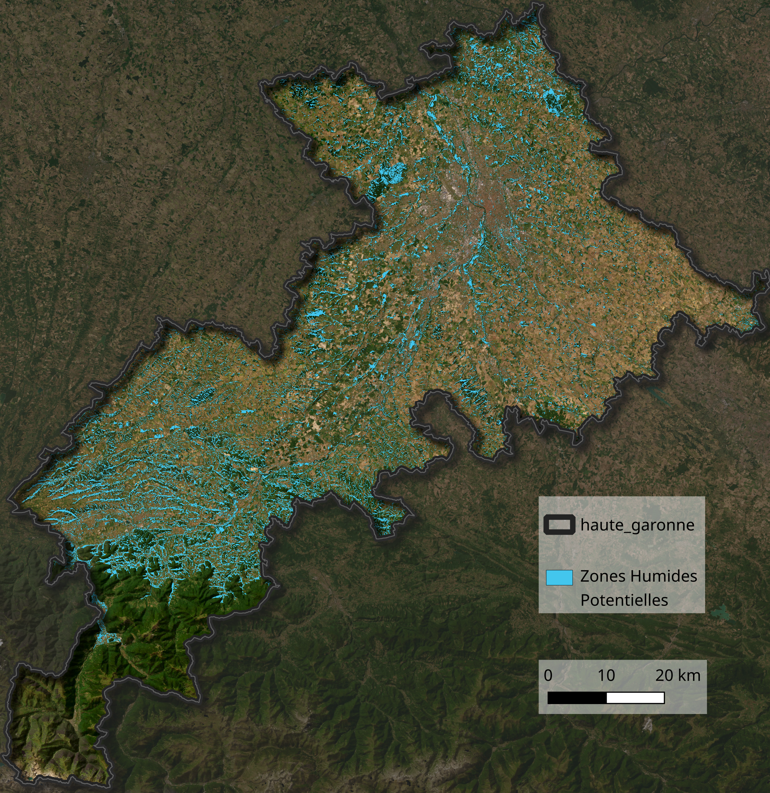
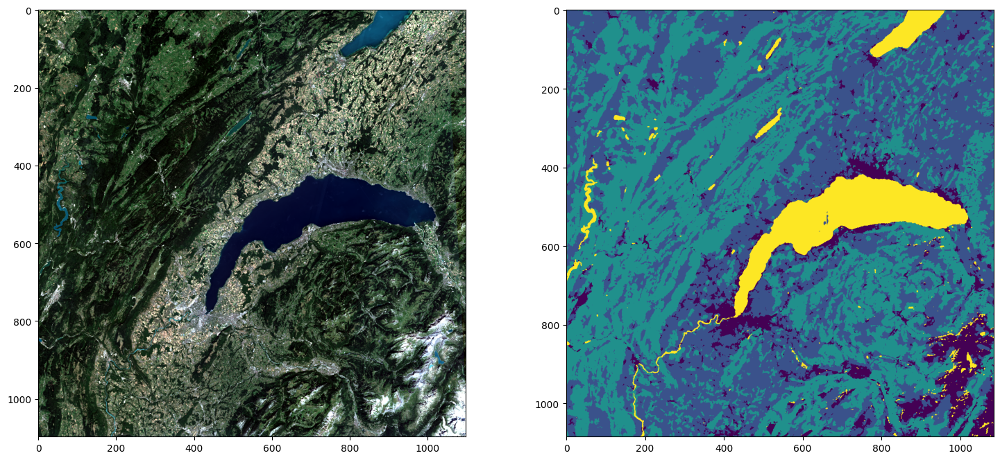
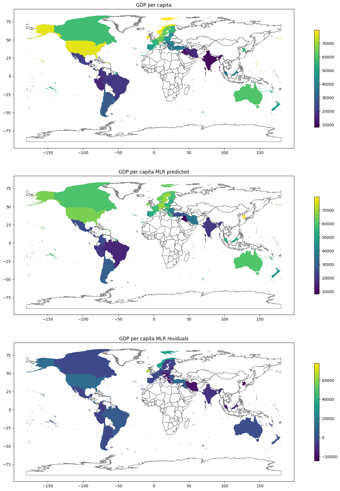

[Stage Détection de zones humides](#zh)  
[Projet d'analyse du report modal train/voiture](#as)  
[Projet segmentation sémantique par apprentissage profond d'images satellitaires](#unet)  
[Notebook de Statistiques Spatiales](#stats)  

# Stage Détection de zones humides 

Stage réalisé d'avril à octobre 2026 au pôle satellitaire du Cerema de Toulouse.  
Adaptation d'une méthode de cartographie des zones humides par intelligence artificielle (random forest) et images satellitaires.  
Dépôt du projet : [stage_detection_zones_humides](https://www.github.com/niels31/stage_detection_zone_humide)  
Supports de soutenance : [diapos](supports_soutenance.pdf)  
[Rapport détaillé](rapport_methodologique.pdf)  

  
   
  <em>Carte des zones humides potentielles de Haute-Garonne</em>

# Projet d'analyse du report modal train/voiture 

Dans le cadre du master IGAST, j'ai mené, avec &Eacute;léonore Lagourgue et Quentin Rameau-Quinchon, un projet d'analyse spatiale consistant à étudier le report modal train/voiture dans la région de Troyes et Auxerre dans un scénario de réouverture d'une voie désaffectée.  
Ce projet s'est appuyé principalement sur de l'analyse de graphe de transport et une modélisation des choix individuels fondée sur la théorie économétrique des choix discrets.  
Dépôt du projet : [projet_as](https://www.github.com/niels31/projet_as)  
Supports de soutenance : [diapos](supports_projet_as.pdf)  
[Rapport détaillé](rapport_projet_as.pdf)

# Projet segmentation sémantique par apprentissage profond d'images satellitaires 

Dans le cadre du master IGAST, j'ai mené avec Titouan Courgey un projet de segmentation sémantique d'images satellitaires par apprentissage profond.  
Ce projet a consisté à préparer un jeu d'entraînement, sous la forme d'un Dataset pytorch de vignettes issues d'images optique Sentinel-2 et de labels issus du Corine Land Cover.  
Puis nous avons réimplémenté à la main un U-Net à partir des modules pytorch, que nous avons entraîné sur ce jeu de données.  
Dépôt du projet : [segmentation_unet](https://github.com/niels31/segmentation_semantique_UNet_S2)  

  
   
  <em>Exemple d'image S2 et de l'inférence du modèle sur le lac de Lausanne</em>

# Notebook de Statistiques Spatiales 
Notebook présentant une exploration d'un jeu de données issu de [ourworldindata](https://www.ourworldindata.org) et de la [World Inequality Database](wid.world) à partir des outils principaux de statistiques et de statistiques spatiales : Analyse en Composantes Principales, régression multiples, régressions multiples pondérées géographiquement, auto-corrélation spatiale, Classification Ascendante Hiérarchique.  

[Page Web présentant l'analyse.](https://niels31.github.io/tp_statistiques_spatiales)

   
  <strong>Cartographie des prédictions et résidus d'une régression linéaire multiple du PIB par habitant en fonction d'indices d'inégalité, du nombre moyen d'années de scolarisation et du pourcentage du PIB consacré à la recherche</strong>
   
  <em>Lecture : Cette analyse suggère que ces variables explicatives sont assez bonnes pour prédire le PIB par habitant et que les sous-estimations du PIB par habitant (forts résidus) sont concentrées dans les pays producteurs de pétrole ou connus comme paradis fiscaux.
  </em>
   

